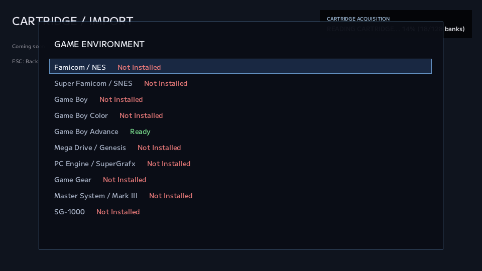

# #38 — 開発PCの外でも、ゲーム機になった

NOA Systemは、開発用のPCでは動いていました。

でも、それはまだ「別のPCへ持っていけば動く」と同じではありません。

ソースコードのある場所。

開発用のフォルダ構成。

ビルドに使っている道具。

そうしたものを、知らないうちに当てにしているかもしれません。

そこで、別のWindows PCへコピーして起動する、Portable Test Buildを作ることにしました。

最初の目標は、立派なInstallerではありません。

**展開して、起動して、遊べること。**

---

## 一つのexeに、全部を詰め込まなくてもいい

必要なものを整理すると、三つに分かれました。

アプリ本体やフォントなど、最初から用意するもの。

Coreのように、NOAが後から取得して管理するもの。

LibraryやSaveのように、使い始めてから生まれるもの。

全部を最初からZIPへ入れる必要はありません。

空のLibraryを配るより、初回起動で作れる方が自然です。

Coreも、すでにGame Environmentから準備できます。

フォントはexeへ埋め込む方法も考えましたが、今回はファイルとして同梱することにしました。

目標はsingle-file化ではなく、フォルダごと持っていけば自己完結することだからです。

必要になっていない複雑さは、ここでは増やしませんでした。

---

## 持っていった先で、勝手に別の場所を使わない

もう一つ重要だったのが、データを置く場所です。

開発中は、実行ファイルの上の階層から開発用の目印を探し、作業場所を見つける仕組みがありました。

でもPortable版まで同じ動きだと、置いた場所によって保存先が変わりかねません。

開発用の設定が残っていれば、別の場所へ向かってしまう可能性もあります。

そこでPortable buildでは、実行ファイルのあるフォルダを基準に固定しました。

開発用の探索やoverrideは、そのbuildでは使いません。

LibraryもRuntimeも、持っていったフォルダの中にできる。

**動くだけでなく、どこに何ができるかも分かる。**

ここまでが、Portableの約束です。

---

## 別のPCで見つかったのは、別の問題だった

実際の確認には、手元のWindows handheldを使いました。

ZIPを展開して起動する。

空の状態から必要なフォルダができる。

コントローラーを認識する。

そこまでは進みました。

ところが、CoreのInstallで止まります。

GBA向けのmGBAだけ成功し、ほかは失敗する。

*検証途中のGame Environment。この表示だけでは、Portable側の問題か配布物側の問題か、まだ分かりません。*

新しく作ったPortable版の問題に見えましたが、調べると開発PCでも再現しました。

配布元の「latest」が更新され、登録していたhashと取得したファイルが一致しなくなっていたのです。

Portable対応が壊れていたのではなく、別の環境で確かめたことで既存の課題が見えました。

この時は取得物を確認し直してcatalogを更新し、Install失敗の詳細も診断ログへ残すようにしました。

ただし、変化する配布物をどう固定するかという根本の問題は、別の課題として残っています。

---

## 画面が出た、その先まで

Coreの準備を通した後は、実物のカートリッジも読み出しました。

SFC、Mega Drive、PC Engine。

読み出して、Importし、PLAYする。

開発用の道具を入れていない別の機器で、その一周ができました。

Screenshot、AutoSnap、手動Snapの生成も確認しています。

ここで確認したのは、この三つのSystemの実機利用です。

全Systemを一度に検証できた、という話ではありません。

それでも、開発PCの中で積み上げてきた仕組みが、外へ持ち出してもつながった意味は大きいものでした。

---

## 起動できることと、ゲームを見分けられること

最初のPortable treeには、ROMを照合するDatabaseを入れていませんでした。

その状態でも、アプリは落ちずにUnknownとして扱えます。

ただ、せっかく読み出せてもタイトルを照合できないのは、普段の体験とは少し違います。

そこで続けて、当時の照合対象だった5 System分の生成済みDatabaseを、個人利用の試験用Packageへ含めるところまで進めました。

元資料のversionやhash、生成に使った情報を追跡できるようにする。

さらに、生成されたDatabase自身のhashも、外側のmanifestへ記録する。

材料が何だったかと、出来上がったものが何かは、別の記録です。

実機では、Databaseを含めた状態でタイトル照合とImportも確認できました。

なお、この試験は公開配布の開始ではありません。

当時、Databaseの再配布条件には確認中の項目があり、個人利用での動作確認と第三者への公開は分けて進めていました。

この記事でも、Databaseやゲームデータを配布するものではありません。

---

## まだ配るためではなく、外で使うために

Installer、自動更新、正式な配布形態。

そこまでを今回作ったわけではありません。

カートリッジアダプターの接続タイミングなど、持ち出して初めて気になるところもありました。

それでも、ZIPを別のPCへ持っていき、コントローラーで遊ぶところまで進めた。

NOA Systemが、開発環境の中だけにあるものではなくなった。

次に直したいことが増えたのも、実際に外へ持ち出せたからでした。

---

## micから

Portable版ということで何となく確認を始めたこの機能だけど、ちょうど手元にあったROG Xbox AllyX でちゃんと起動して遊べるところまで行けて良かった。
配布できるレベルにはまだまだだけど、検証として通ったのがとても大きい。

で、気になる箇所もまたたくさん出てきちゃったんだけど、このissueとしては大成功だからよしとする。

---

思いつきで始めたPortable対応だけど、ROG Xbox Ally X で動いてるのを見るとちょっと感動。
DBの扱いについても話が進んだのでちょっとずつ配布の準備も進んでいる。
配布って言っても、まだ全然完成してないんだけどね。

--- mic

---

← [前の日記 #37 — 借りている部品の、来た道を残す](0037-remember-where-the-parts-came-from.md)
